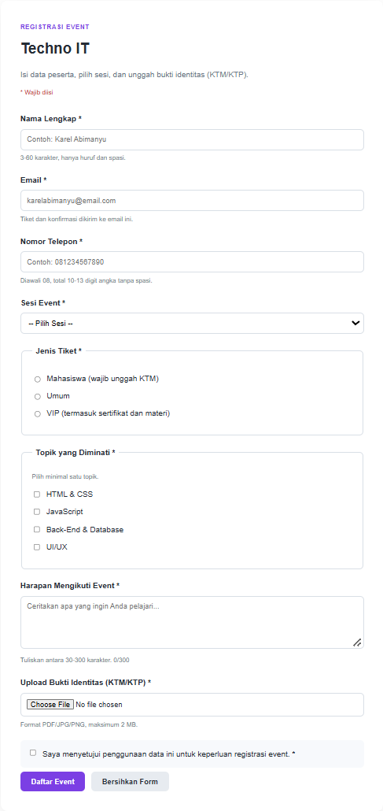
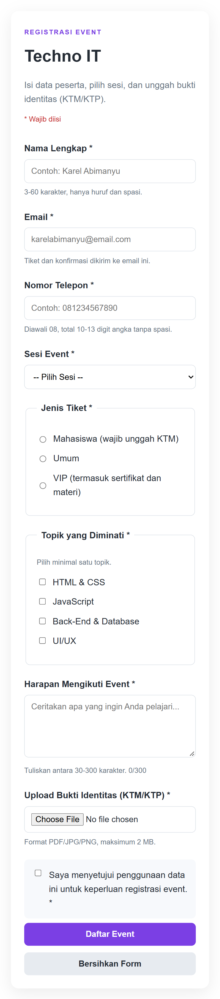

# Techno IT – Event Registration Form

Aplikasi Form Registrasi Event Techno IT merupakan halaman pendaftaran event teknologi yang dibuat menggunakan HTML, CSS, dan JavaScript murni (Vanilla JavaScript).

Project ini dibuat sebagai tugas individu Praktikum Desain Web (Pertemuan 8) untuk menerapkan berbagai komponen form serta validasi input pada sisi Front-End.

## ✨ Fitur Utama

- **Nama Lengkap**: Input nama peserta.
- **Email**: Input alamat email peserta.
- **Nomor Telepon**: Input nomor telepon peserta.
- **Select Option**: Memilih sesi event (pagi, siang, atau online).
- **Radio Button**: Memilih jenis tiket (Mahasiswa, Umum, atau VIP).
- **Checkbox**: Memilih topik teknologi yang diminati.
- **Textarea**: Menuliskan harapan mengikuti event, dilengkapi penghitung karakter.
- **File Upload**: Mengunggah bukti identitas (KTM/KTP).
- **Checkbox Persetujuan**: Menyetujui penggunaan data untuk keperluan registrasi.
- **Form Validation**: Memvalidasi seluruh input sebelum pendaftaran dinyatakan berhasil.
- **Responsive Design**: Tampilan menyesuaikan ukuran layar desktop dan mobile.

## 🛠️ Teknologi yang Digunakan

| Teknologi | Kegunaan |
|---|---|
| HTML5 | Membuat struktur form |
| CSS3 | Mengatur tampilan dan desain |
| JavaScript | Membuat validasi input |

## 📁 Struktur Project

```
Pertemuan8-Praktikum-DW-A-4525210031-Karel-Abimanyu/
│
├── index.html
├── DOKUMENTASI.md
├── README.md
├── css/
│   └── style.css
├── js/
│   └── validasi.js
└── img/
    ├── outputdesktop.png
    └── outputmobile.png
```

Struktur kode dipisah menjadi tiga bagian: `index.html` untuk struktur form, `css/style.css` untuk tampilan, dan `js/validasi.js` untuk logika validasi.

## 📋 Aturan Validasi

Berikut aturan validasi yang diterapkan pada form:

1. Nama lengkap wajib diisi, 3-60 karakter, hanya huruf dan spasi.
2. Email wajib menggunakan format email yang valid.
3. Nomor telepon wajib diisi, diawali `08`, dan berisi 10-13 digit angka.
4. Sesi event wajib dipilih.
5. Jenis tiket wajib dipilih.
6. Minimal satu topik minat harus dipilih.
7. Harapan mengikuti event wajib diisi, 30-300 karakter.
8. Bukti identitas wajib diunggah dengan format PDF, JPG, atau PNG.
9. Ukuran file maksimal 2 MB.
10. Persetujuan penggunaan data wajib dicentang.

## 🚀 Cara Menjalankan Project

1. Download atau clone repository ini.
2. Buka folder project menggunakan Visual Studio Code.
3. Buka file `index.html` menggunakan browser.
4. Isi seluruh data pada form registrasi.
5. Klik tombol **Daftar Event**.
6. Perhatikan pesan validasi yang muncul apabila terdapat input yang tidak sesuai.
7. Klik tombol **Bersihkan Form** untuk mengosongkan seluruh isian.

## 🧪 Pengujian Form

Pengujian dilakukan dengan mencoba beberapa skenario input yang tidak valid, seperti:

| No | Skenario Pengujian | Hasil yang Diharapkan |
|---|---|---|
| 1 | Semua data valid dan lengkap | Tidak ada error, muncul banner sukses |
| 2 | Nama dikosongkan | Muncul pesan nama wajib diisi |
| 3 | Nama berisi angka (`Budi123`) | Muncul pesan nama hanya boleh huruf dan spasi |
| 4 | Email menggunakan format salah (`saipul@`) | Muncul pesan format email tidak valid |
| 5 | Nomor telepon berisi huruf (`0812abc`) | Muncul pesan nomor harus diawali 08 dan 10-13 digit angka |
| 6 | Nomor telepon tidak diawali 08 (`12345`) | Muncul pesan nomor harus diawali 08 dan 10-13 digit angka |
| 7 | Sesi event tidak dipilih | Muncul pesan wajib memilih sesi event |
| 8 | Jenis tiket tidak dipilih | Muncul pesan wajib memilih jenis tiket |
| 9 | Tidak memilih topik minat | Muncul pesan minimal satu topik harus dipilih |
| 10 | Harapan kurang dari 30 karakter | Muncul pesan minimal 30 karakter |
| 11 | Harapan lebih dari 300 karakter | Muncul pesan maksimal 300 karakter |
| 12 | Format file tidak sesuai (`virus.exe`) | Muncul pesan format file harus PDF, JPG, atau PNG |
| 13 | File berukuran lebih dari 2 MB | Muncul pesan ukuran file maksimal 2 MB |
| 14 | File tidak diunggah | Muncul pesan bukti identitas wajib diunggah |
| 15 | Persetujuan tidak dicentang | Muncul pesan wajib menyetujui penggunaan data |

Hasil pengujian lengkap beserta hasil aktualnya dapat dilihat pada [DOKUMENTASI.md](DOKUMENTASI.md).

## Validasi Client-Side

Seluruh proses validasi dilakukan menggunakan JavaScript di browser (Client-Side Validation). Form diberi atribut `novalidate` sehingga pesan error ditampilkan oleh JavaScript tepat di bawah setiap field, bukan oleh pesan bawaan browser.

Validasi ini meliputi pemeriksaan:

- Input kosong.
- Format email dan nomor telepon.
- Minimal dan maksimal panjang karakter.
- Pilihan select, radio, dan checkbox.
- Format serta ukuran file yang diunggah.
- Persetujuan penggunaan data.

> **Catatan:** Project ini hanya menggunakan Front-End. Data pendaftaran belum dikirim atau disimpan ke database maupun server. Pada penerapan sebenarnya, seluruh aturan validasi tetap harus diulang di sisi server karena validasi di browser dapat dilewati.

## Tampilan Aplikasi

Aplikasi dirancang dengan konsep bersih dan modern menggunakan aksen warna ungu dengan latar putih. Desain dibuat responsif sehingga dapat digunakan melalui perangkat desktop maupun mobile.

## Output

### Tampilan Desktop



### Tampilan Mobile



## Informasi Project

| | |
|---|---|
| **Nama Project** | Techno IT |
| **Jenis Project** | Event Registration Form |
| **Kategori** | Front-End Development |
| **Bahasa** | HTML, CSS, JavaScript |
| **Mata Kuliah** | Praktikum Desain Web |
| **Nama** | Karel Abimanyu Ahpandi |
| **NIM** | 4525210031 |
| **Kelas** | A |
| **Tahun** | 2026 |
